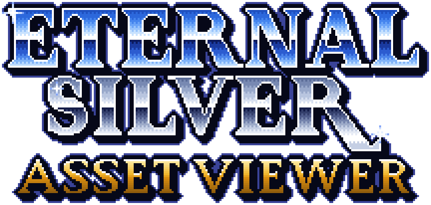

  

# Eternal Silver Asset Viewer

Look inside your own copies of the Lunar games for the PlayStation. Walk
every map and click the people standing on it, watch every sprite and
monster animate, read every line of dialogue with its portrait, listen to
the soundtrack and every voice line, look up items, spells and monsters,
watch the movies, and save any picture or song you like.

It is a free desktop app for Windows, macOS and Linux. It does not come
with the games: it reads disc images you make from your own discs. It
never changes them and never goes online.

## Which games

| Game | Its discs | What you can see |
|---|---|---|
| *Lunar: Silver Star Story Complete* (US) | both game discs, *The Making of* bonus disc, the demo | everything |
| *Lunar: Silver Star Story* (Japan) | both game discs | everything but the shops' stock and the chests' money, not found yet |
| *Lunar 2: Eternal Blue Complete* (US) | all three game discs, *The Making of* bonus disc, the demo | **not fully supported yet**: its movies, and in Advanced mode its files |

A bonus disc or a demo adds its own movies to its game. Discs of other
games are not read. Lunar 2 in full is the aim.

## Installing it

Download the app for your system from this repository's
[Releases](../../releases) page. Nothing else needs installing.

- **Windows**: the `-setup.exe` (or the `.msi`).
- **macOS**: the `.dmg`: `aarch64` for Apple silicon (M1 and later), `x64`
  for an Intel Mac. Open it and drag the app to Applications.
- **Linux**: the `.AppImage` (make it executable, then run it), or the
  `.deb` or `.rpm` for your distribution.

The app is not signed, so the first time you open it your system warns you:

- **macOS** says it cannot verify the developer. Open **System Settings →
  Privacy & Security**, and under the message about the app choose **Open
  Anyway**. It asks once.
- **Windows** SmartScreen says it protected your PC. Choose **More info →
  Run anyway**.

## Getting started

1. **Make images of your discs.** Copy each disc with a disc-imaging
   program as a `.cue` file with its `.bin` file or files: a raw copy of
   every track. Put the images in one folder. (An `.iso` opens too, but
   holds less: no CD audio, voices or movie sound.)
2. **Start the app.** The first start on a computer can take a minute or
   more. It opens on the Library: a card for each game, listing every disc
   of it.
3. **Add your discs.** Click **Add a folder…** and choose the folder with
   your images. The app finds every disc image in it and copies the disc's
   files into its library. Or use **Add…** beside one disc on a card. A
   disc the app recognises as a good copy gets a green check.
4. **Open the game.** Click **Open** on its card. The bar on the left lists
   what you can look at, as icons (hold the pointer over one for its name);
   pick a tab, then pick something from its list.

Keep your disc images where they are: the app plays the CD audio, the
voices and the movies' sound straight from them.

## What you will find

The bar on the left groups the tabs the way a fan wiki does:

- **World.** **Maps**: the overworld, every town and every dungeon, drawn
  as the game draws them, with their people, monsters and chests moving.
  Click anyone to see who they are, and play the place's music.
- **Cast.** **Characters**: stats at every level, magic, starting
  equipment. **Monsters**: stats, drops, attacks, where you meet them.
  **Portraits**: every face shown beside the dialogue. **Sprites**:
  everyone's animations, on the map and in battle.
- **Story.** **Dialogue**: everything said, scene by scene, with who says
  it, in the game's own message window if you like. **Movies**: the
  animated scenes, with their sound. **Story flags**: what the game
  remembers you have done, and what each one changes.
- **Adventure.** **Items**: every item, shop and treasure chest.
  **Magic**: every spell, by who learns it. **Battles**: every fight in its
  arena, where it is met and what it plays.
- **Sound.** **Music**: the soundtrack by the game's own titles, and where
  each song plays. **Voices**: every spoken line, by who says it. **Sound
  effects**: every one, and where the game plays it.
- **Art.** **Bromides**: the bromide pictures with their spoken lines.
  **Menus**: the menus' letters, icons and cursors. **Screens**: the title
  screen and the game's other full-screen pictures.

Everything links to everything it touches: a monster lists the battles it
is in, an item the chests, shops and monsters that give it. Click a link to
go there; **Alt+←** (**⌥←** on a Mac) comes back.

The bar's **ADV** switch, under the tabs, turns on **Advanced mode**: how
the game stores all this. The disc's files, the game's archive, its sound
banks, the program's tables and strings, and for every fact the part of
the game's code that proves it.

## Saving pictures and sounds

- **A picture**: the download button above it saves it as a PNG.
- **A map**: its **Export** saves the map as shown, each area, its layers
  apart or its tileset, at 1×, 2× or 4×.
- **A song, a voice or a sound**: **Export** on the player bar along the
  top saves a WAV, and a song also as MIDI.

Everything goes in the library's `exports` folders. The message that says
it is saved has a **Show in folder** button.

## Questions

**My system will not open the app.** It is not signed: see
[Installing it](#installing-it).

**A disc says "identified by SYSTEM.CNF only".** The app knows the disc by
its label, but the image does not match a known good copy. It may be
damaged, or made another way (an `.iso`, say). It still opens; if
something in it looks wrong, make the image again.

**A disc says "disc image not found".** Its image was moved or deleted
after it was added, and the disc's CD audio, voices and movie sound need
it. Put it back, or use the disc's re-extract button (shown when the
pointer is over the disc): it asks where the image is now.

**The Japanese text shows boxes.** The app draws the Japanese discs' kanji
with a Japanese font from your computer: install one, then restart the app.
[The guide](docs/guide.md#when-something-goes-wrong) says which fonts it
looks for.

**Where does it keep its files, and how much room do they take?** In its
library folder. Each disc takes about as much room as its image. The
folder is:

- Windows: `%LOCALAPPDATA%\eternal-silver-asset-viewer\library`
- macOS: `~/Library/Application Support/eternal-silver-asset-viewer/library`
- Linux: `~/.local/share/eternal-silver-asset-viewer/library`

The Library's folder button switches to another folder; what the old one
holds stays there.

**It says "The backend did not start".** The part that reads the discs
took too long to start, which can happen the first time. Choose **Try
again**.

**Does it send anything anywhere?** No. It works without the internet; its
two halves, the window and the part that reads the discs, talk only to
each other, on your computer.

**On Linux, the terminal shows `MESA-EGL: warning: … failed to create dri2
screen`.** Harmless: the window's graphics library trying more than one
graphics driver. It happens on some graphics cards, NVIDIA's among them.

## More

- [The user guide](docs/guide.md): every screen, button and tab in detail.
- [For developers](docs/development.md): running it from source, the
  checks, the release build, and how the code is laid out.
- [Names](docs/taxonomy.md): what every kind of thing is called in the
  viewer, how it is numbered and how the kinds link.
- [Releases](docs/release.md): how a release is made.

## Licence

MIT (`LICENSE`), © 2026 Bash Alarmist. It covers this repository's own work
and nothing of the games, which are their owners'. This repository holds
none of the games' files. [`NOTICE.md`](NOTICE.md) says what the licence
covers and credits what the viewer stands on.
